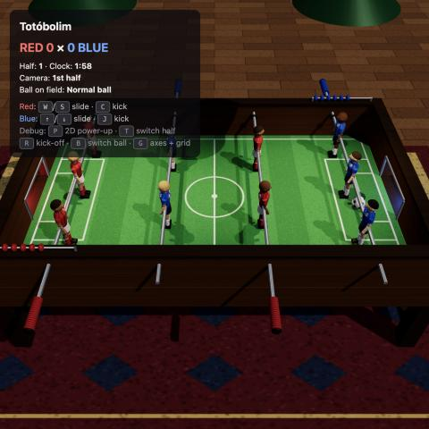
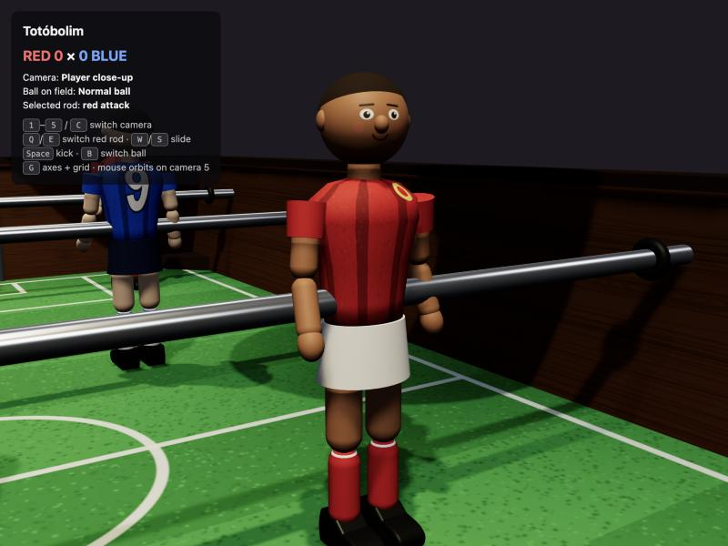
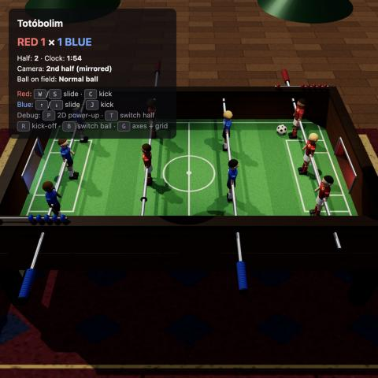
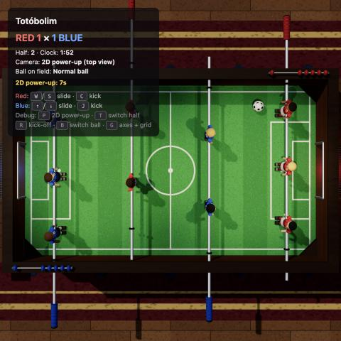

# Totóbolim: Modelagem 3D e cena inicial

Relatório da etapa **"Modelagem 3D e construção inicial da cena"** do trabalho final de Computação Gráfica.
A proposta do jogo está em [Ideia.md](Ideia.md).



---

## 1. Como executar

O projeto usa **Three.js r160** carregado via CDN (import map) e módulos ES (`type="module"`).
Navegadores bloqueiam módulos ES abertos via `file://`, então é preciso um servidor HTTP local:

```bash
cd "Trabalho Final"
python3 -m http.server 8765
```

Depois abra `http://localhost:8765`.

As **duas hastes de cada time são controladas ao mesmo tempo**, o que simplifica o jogo:

| Time | Deslizar | Chutar |
|---|---|---|
| Vermelho | `W` / `S` | `C` |
| Azul | `↑` / `↓` | `J` |

"Para cima" é relativo à tela. No 2º tempo a câmera fica do lado oposto da mesa, então o sentido em Z se inverte para que `W` e `↑` continuem movendo os bonecos para cima na tela.

Teclas de depuração desta etapa:

| Tecla | Ação |
|---|---|
| `P` | Ativa o power-up "visão 2D" por 8 s |
| `T` | Alterna entre 1º e 2º tempo sem esperar o relógio |
| `R` | Nova saída de bola (lado sorteado) |
| `B` | Alterna a bola em campo (normal, pesada, leve) |
| `G` | Mostra/esconde eixos XYZ e grade de 1 unidade (para conferir posições e escalas) |

**Saída de bola:** no início da partida, de cada tempo e depois de cada gol, a bola parte do centro para um lado **sorteado** (+X ou −X), com um pequeno ângulo aleatório. A velocidade inicial depende da massa da bola, então a leve sai mais rápida e a pesada mais lenta.

Já existe uma prévia de movimento da bola: atrito, quique nas paredes, detecção de gol, placar no HUD e contas do ábaco. **A colisão da bola com os bonecos ainda não existe**, então nesta etapa a bola atravessa os jogadores.

---

## 2. Estrutura dos arquivos

```
Trabalho Final/
├── index.html          # página, HUD e import map do Three.js
├── Ideia.md            # proposta do jogo
├── Relatorio-Modelagem.md
├── screenshots/        # capturas das câmeras e do personagem
└── src/
    ├── main.js         # renderer, câmera, partida (tempos, power-up, saída de bola), entrada, animação
    ├── player.js       # PERSONAGEM: boneco humanoide de pebolim
    ├── table.js        # mesa, campo, paredes, gols, rampas, hastes, ábacos
    ├── balls.js        # 3 tipos de bola + expositor
    ├── environment.js  # sala (piso/tapete), luminárias e luzes
    └── textures.js     # todas as texturas (geradas proceduralmente em canvas)
```

---

## 3. Personagem: o boneco de pebolim (`src/player.js`)

### 3.1 Como foi modelado

O personagem é um **modelo hierárquico** (grafo de cena) montado com `THREE.Group`. Cada articulação é um grupo-pivô, e as malhas ficam penduradas nele. Assim, girar um pivô move toda a parte do corpo abaixo dele, como nas transformações compostas vistas em aula (helicóptero e robô dançarino).

- **Origem do modelo:** o ponto onde a haste atravessa o peito. Com isso, girar a haste (`rotation.z`) faz o boneco girar em torno dela, que é exatamente o movimento de chute do pebolim (ver [screenshots/kick.jpg](screenshots/kick.jpg)).
- **Orientação:** o modelo é construído olhando para **+Z local**. Ao ser colocado na haste, recebe `rotation.y = ±π/2`: o time vermelho olha para +X e o azul para −X, ou seja, para o gol adversário.
- **Escala:** cerca de 1,9 unidade de altura. A bola normal tem 0,44 de diâmetro (proporção próxima à de um pebolim real), e os pés ficam a cerca de 0,02 do gramado.

```
player (origem = haste)
 ├─ torso (Lathe + textura de camisa), shorts, pescoço, parafusos da haste
 ├─ head ─ rosto (esfera texturizada), cabelo (calota), orelhas, nariz
 ├─ leftArm / rightArm  (pivô do ombro)
 │    ├─ manga, braço
 │    └─ elbow (pivô do cotovelo) ─ antebraço, mão
 └─ leftLeg / rightLeg  (pivô do quadril)
      ├─ coxa
      └─ knee (pivô do joelho) ─ canela/meião, chuteira, 4 travas
```

São **10 bonecos**: 5 por time, com 3 na defesa e 2 no ataque, conforme a proposta. Cada boneco tem 32 malhas.

### 3.2 Primitivas e malhas usadas no personagem

| Parte | Geometria Three.js | Observação |
|---|---|---|
| Tronco | **`LatheGeometry`** (malha de revolução) | Perfil 2D de 9 pontos girado em torno de Y (cintura fina, ombros largos), achatado em Z (`scale.z = 0.72`) para ter seção elíptica |
| Chuteira | **`ExtrudeGeometry`** de um `Shape` 2D | Perfil lateral do pé com curvas quadráticas e bisel, extrudado e girado para o bico apontar para +Z |
| Cabeça/rosto | `SphereGeometry` | Textura de rosto desenhada no mapa equirretangular |
| Cabelo | `SphereGeometry` parcial (`thetaLength = 0.42π`) | Calota esférica inclinada para trás |
| Orelhas, nariz, mãos | `SphereGeometry` com escala não uniforme | Elipsoides |
| Braços, antebraços, coxas, canelas | `CapsuleGeometry` | Cápsulas (cilindro com pontas esféricas) |
| Shorts, mangas, pescoço | `CylinderGeometry` (tronco de cone) | |
| Parafusos da haste, travas | `CylinderGeometry` | |

### 3.3 Variações e texturas do personagem

- **Camisa:** textura gerada com o número do jogador nas costas, listras, gola e escudo no peito. Cada boneco tem a sua.
- **Meião:** textura de faixas horizontais com as cores do time.
- **Rosto:** olhos, sobrancelhas, boca e bochechas desenhados em canvas.
- **Variações:** 5 tons de pele e 5 cores de cabelo, alternados entre os bonecos.
- **Times:** vermelho (camisa vermelha listrada e calção branco) e azul (camisa azul listrada e calção marinho).



---

## 4. Cena 3D inicial

### 4.1 Sistema de coordenadas

- Tampo do campo em **y = 0**, campo de **12 × 7** unidades no plano XZ.
- **Eixo X** = comprimento do campo. O gol vermelho fica em x = −6 e o azul em x = +6.
- **Eixo Z** = largura. As hastes ficam ao longo de Z.
- Piso da sala em **y = −3,6**, o que corresponde à altura da mesa.

| Haste | Time | x | Jogadores (z) | Curso de deslize |
|---|---|---|---|---|
| Defesa | Vermelho | −4,5 | −2,2 / 0 / 2,2 | ±0,95 |
| Ataque | Azul | −1,5 | −1,4 / 1,4 | ±1,75 |
| Ataque | Vermelho | +1,5 | −1,4 / 1,4 | ±1,75 |
| Defesa | Azul | +4,5 | −2,2 / 0 / 2,2 | ±0,95 |

As linhas são **intercaladas** como em um pebolim real: a defesa de cada time fica perto do próprio gol e o ataque fica a 1,5 do centro. Os cursos foram calculados para o boneco não atravessar a parede (`travel = W/2 − 0,35 − maior z do slot`).

### 4.2 Elementos do cenário (`src/table.js`, `src/environment.js`, `src/balls.js`)

| Elemento | Construção |
|---|---|
| Campo | `PlaneGeometry` com textura de grama listrada e marcações (linha central, círculo, grandes e pequenas áreas, marcas de pênalti) |
| Paredes laterais e de fundo | `BoxGeometry` com textura de madeira. A parede do fundo tem 3 peças para formar a **abertura do gol** |
| Gols | Traves e travessão (`CylinderGeometry` metálico), piso e **rede** (`PlaneGeometry` com textura transparente e `alphaTest`) |
| Rampas de canto (obstáculos) | `ExtrudeGeometry` de um triângulo, giradas para cada canto |
| Hastes | `CylinderGeometry` metálico com reflexo (env map). Manopla com textura emborrachada, ponteira e **para-choques** (`TorusGeometry`). A manopla do time vermelho fica em +Z e a do azul em −Z |
| Gabinete, pés, sapatas e travessas | `BoxGeometry` e `CylinderGeometry` |
| Marcadores de gol (ábaco) | Fio com 6 contas por time (`SphereGeometry` achatada), uma conta para cada gol necessário para vencer |
| Bolas | 3 `SphereGeometry` com raios e texturas diferentes (normal: gomos de futebol; pesada: ferro com rebites e "10KG"; leve: bola de praia maior) |
| Expositor de bolas | Base, coluna, bandeja e berços (`TorusGeometry`) ao lado da mesa, com as 2 bolas que não estão em jogo |
| Sala | Piso de tacos e tapete (`PlaneGeometry` texturizado) |
| Luminárias pendentes | Fio, cúpula (`CylinderGeometry` aberto, `openEnded`) e lâmpada emissiva |

### 4.3 Câmeras (projeção perspectiva)

Há uma única `PerspectiveCamera` que **transita suavemente** (interpolação de posição, alvo e FOV) entre três poses:

| Pose | Quando | Posição → alvo |
|---|---|---|
| **1º tempo** | Início da partida | (0; 11; 11,5) → (0; −0,5; 0,4): elevada e inclinada, do lado das manoplas vermelhas |
| **2º tempo** | Quando o relógio do 1º tempo zera (120 s) | (0; 11; −11,5) → (0; −0,5; −0,4): mesma câmera espelhada, do lado oposto da mesa |
| **Power-up "visão 2D"** | Durante 8 s quando o power-up é ativado | (0; 17; ±0,01) → (0; 0; 0): vista de cima, o jogo parece um Pong |

Na vista de cima, o pequeno deslocamento em Z (±0,01) segue o tempo atual para manter a mesma orientação de tela. Quando o power-up acaba, a câmera volta para a pose do tempo em andamento.





### 4.4 Iluminação (6 fontes de luz)

| Luz | Tipo | Papel |
|---|---|---|
| Ambiente | `HemisphereLight` | Preenche as áreas escuras (céu frio, chão quente) |
| "Janela" | `DirectionalLight` com sombra | Luz principal e sombras dos bonecos |
| 2 luminárias | `SpotLight` com sombra | Iluminação de "bar" sobre cada metade da mesa |
| 2 gols | `PointLight` (vermelha e azul) | Destaque colorido dentro de cada gol |

### 4.5 Texturas (`src/textures.js`)

Todas as texturas são **geradas proceduralmente** com Canvas 2D e convertidas em `THREE.CanvasTexture`. Nenhum arquivo de imagem externo foi usado.

São 12 tipos de textura: campo, madeira (2 variações), tacos do piso, tapete, rede, manopla (2 cores), camisa (uma por jogador), meião (2 times), rosto (um por tom de pele), bola normal, bola pesada e bola leve.

---

## 5. Origem dos modelos e bibliotecas

- **Modelos 3D:** todos foram criados pelo grupo, em código, a partir de primitivas e malhas paramétricas do Three.js. **Nenhum modelo externo** (OBJ, GLTF, FBX) foi usado.
- **Texturas:** todas geradas pelo grupo, em código.
- **Bibliotecas externas:**
  - [Three.js r160](https://github.com/mrdoob/three.js/tree/r160) (licença MIT), carregado via [jsDelivr](https://cdn.jsdelivr.net/npm/three@0.160.0/).
  - Addon do Three.js: [`RoomEnvironment`](https://github.com/mrdoob/three.js/blob/r160/examples/jsm/environments/RoomEnvironment.js) (mapa de reflexo das peças metálicas).
- **Referências da API:** [LatheGeometry](https://threejs.org/docs/#api/en/geometries/LatheGeometry), [ExtrudeGeometry](https://threejs.org/docs/#api/en/geometries/ExtrudeGeometry), [CapsuleGeometry](https://threejs.org/docs/#api/en/geometries/CapsuleGeometry), [SphereGeometry](https://threejs.org/docs/#api/en/geometries/SphereGeometry), [CanvasTexture](https://threejs.org/docs/#api/en/textures/CanvasTexture), [Layers](https://threejs.org/docs/#api/en/core/Layers).

---

## 6. Principais dificuldades

1. **Mapear o rosto na esfera.** A `SphereGeometry` usa projeção equirretangular, e a frente (+Z) fica em `u = 0,25`, não no centro da textura. Foi preciso desenhar olhos e boca em `x = 128` de um canvas de 512 px. No torso (`LatheGeometry`), a frente fica em `u = 0` e as costas em `u = 0,5`, por isso o número foi desenhado no centro do canvas.
2. **Escolher a origem do boneco.** Para o chute girar em torno da haste e não dos pés, a origem do modelo precisou ficar no peito. As medidas de pernas, joelhos e chuteiras foram calculadas a partir desse ponto até os pés quase encostarem no gramado (y ≈ 0,02).
3. **Orientar as peças espelhadas.** A primeira versão das rampas de canto usava `scale` negativo para espelhar. Isso inverte a ordem dos vértices e deixa as faces do avesso. A solução foi girar a mesma geometria em Y para cada canto.
4. **Luminárias tapando a vista de cima.** As cúpulas ficavam entre a câmera e o campo durante o power-up 2D. A solução foi colocar as malhas da luminária na **camada 1** (`Object3D.layers`) e desabilitar essa camada na câmera enquanto o power-up está ativo. As luzes continuam funcionando.
5. **Controles com a câmera espelhada.** No 2º tempo a câmera olha de −Z para +Z, então "para cima" na tela passa a ser +Z. O sentido do deslize é invertido conforme o tempo para que o controle continue intuitivo.
6. **Proporções.** Foi preciso ajustar alturas de parede, haste, bola e boneco para que o boneco ficasse visível por cima da parede na câmera principal e a bola mantivesse uma proporção crível em relação ao jogador.
7. **Texturas sem imagens externas.** Desenhar gomos de bola e rosto em mapa equirretangular gera distorção perto dos polos. Os pentágonos foram esticados horizontalmente para compensar.
8. **Módulos ES e `file://`.** O import map do Three.js só funciona servido por HTTP, então é preciso um servidor local (seção 1).

---

## 7. O que ainda falta implementar

- [x] Saída de bola para um lado sorteado, atrito, quique nas paredes, detecção de gol, placar e ábaco (prévia).
- [x] Controles dos dois times (duas hastes juntas por time).
- [x] Câmeras do 1º e 2º tempo e câmera do power-up 2D, com transição suave.
- [ ] **Colisões da bola com os bonecos:** o chute deve transferir impulso conforme a velocidade angular da haste. Também faltam colisões com rampas e traves.
- [ ] **Power-up em campo:** item que aparece no meio do jogo e ativa a visão 2D quando tocado (hoje é ativado pela tecla `P`).
- [ ] **Condição de vitória** (6 gols) e tela de vitória ou derrota.
- [ ] Chute com força variável.
- [ ] Decidir se o time azul é controlado por um 2º jogador local (controles já prontos) ou por uma IA.
- [ ] **Mecânicas especiais das bolas:** bola pesada atordoa o boneco atingido na cabeça; bola leve pode estourar e atordoar a linha inteira.
- [ ] **Animação de atordoamento** dos bonecos (os pivôs de cabeça, braços e pernas já existem para isso).
- [ ] Ajustes de jogabilidade, sons e otimizações (compartilhar materiais e geometrias entre bonecos).
