# Totóbolim: relatório de evolução

Relatório do trabalho final de Computação Gráfica.

A proposta do jogo está em [Ideia.md](Ideia.md).

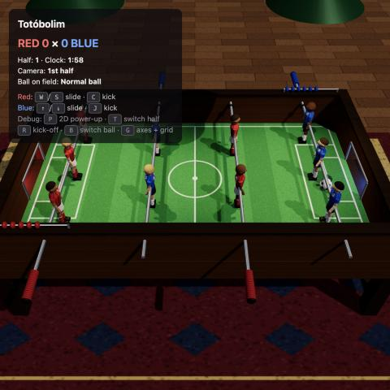

---

## Sumário

0. [Visão geral: tecnologia, execução e controles](#0-visão-geral)
1. [Entrega 1: modelagem 3D e cena inicial](#entrega-1-modelagem-3d-e-cena-inicial)
2. [Entrega 2: câmeras, projeção perspectiva e iluminação](#entrega-2-câmeras-projeção-perspectiva-e-iluminação)
3. [Entrega 3: texturas e materiais](#entrega-3-texturas-e-materiais)
4. [Jogabilidade desenvolvida em paralelo](#4-jogabilidade-desenvolvida-em-paralelo)
5. [Origem dos modelos, texturas e bibliotecas](#5-origem-dos-modelos-texturas-e-bibliotecas)
6. [O que ainda falta implementar](#6-o-que-ainda-falta-implementar)

### Tabela de Evolução

| Entrega | Foco | Principais mudanças |
|---|---|---|
| **1** | Modelagem e cena | Boneco de pebolim hierárquico (32 malhas), 10 jogadores, mesa completa, 3 bolas, sala. |
| **2** | Câmeras, projeção e luz | São 3 câmeras usadas em 1º tempo, 2º tempo (espelhado) e power-up "visão 2D". Na troca de tempo as cameras invertem. Temos 6 luzes, 2 ambientes, 2 das lampadas do cenário e dentro dos gols com as cores de cada time. Elas podem a ser ligada/desligada por tecla (1–6). |
| **3** | Texturas | Imagens externas (modelo glTF da bola normal; texturas PBR de metal na bola pesada, grama no campo, parquet no piso e madeiras clara e escura na mesa), esfera derivada de cubo para evitar distorção, galeria de texturas e PNGs das texturas geradas em código. |
| Paralelo | Jogabilidade | Controles por time, saída de bola sorteada, colisão com os bonecos, chute com raspão, velocidade mínima da bola, curso das hastes e modelo do power-up coletável. |

---

## 0. Visão geral

### Tecnologia

**Three.js r160**

### Como executar

```bash
cd "Trabalho Final"
python3 -m http.server 8765
```

Depois abra `http://localhost:8765`. A galeria de texturas fica em `http://localhost:8765/textures.html`.


### Controles

As **duas hastes de cada time são controladas ao mesmo tempo**:

| Time | Deslizar | Chutar |
|---|---|---|
| Vermelho | `W` / `S` | `C` |
| Azul | `↑` / `↓` | `J` |

"Para cima" é relativo à tela: no 2º tempo a câmera fica do outro lado da mesa, então o sentido em Z se inverte para `W` e `↑` continuarem movendo os bonecos para cima na tela.

Teclas de demonstração:

| Tecla | Ação |
|---|---|
| `G` | Eixos XYZ e grade de 1 unidade (posições e escalas) |
| `T` | Alterna entre 1º e 2º tempo (dispara o giro da câmera) |
| `1` a `6` | Liga/desliga cada fonte de luz |
| `U` | Troca todas as texturas pela grade de UV |
| `B` | Alterna a bola em campo (normal, pesada, leve) |
| `R` | Nova saída de bola (lado sorteado) |
| `H` | Esconde/mostra o painel (para capturas de tela) |

### Estrutura dos arquivos

```
Trabalho Final/
├── index.html              # jogo: página, painel e import map do Three.js
├── textures.html           # galeria com todas as texturas do jogo
├── Ideia.md                # proposta do jogo
├── Relatorio.md            # este relatório
├── screenshots/            # capturas usadas no relatório
├── assets/
│   ├── models/football/        # bola normal (glTF, Poly Haven)
│   └── textures/
│       ├── metal059c/          # bola pesada (PBR, ambientCG)
│       ├── grass005/           # grama do campo (PBR, ambientCG)
│       ├── woodfloor070/       # piso da sala (PBR, ambientCG)
│       ├── wood026/            # madeira clara da mesa (PBR, ambientCG)
│       ├── wood051/            # madeira escura da mesa (PBR, ambientCG)
│       └── generated/          # PNGs das texturas geradas em código
└── src/
    ├── main.js             # renderer, câmera, partida, entrada, animação
    ├── player.js           # personagem: boneco de pebolim
    ├── table.js            # mesa, campo, paredes, gols, rampas, hastes, ábacos
    ├── balls.js            # 3 tipos de bola + expositor
    ├── powerup.js          # modelo do power-up coletável
    ├── environment.js      # sala, luminárias e as 6 luzes
    ├── physics.js          # movimento da bola, colisões e chute
    ├── textures.js         # texturas geradas em canvas (incluindo a grade de UV) e carregador das fotográficas
    ├── uv.js               # UVs em unidades do mundo para as peças de madeira
    └── texture-gallery.js  # lógica da página textures.html
```

---

## Entrega 1: modelagem 3D e cena inicial

Os dois times usam o mesmo modelo de boneco mas com cores, números e variações diferentes.

### 1.1 Personagem: o boneco de pebolim (`src/player.js`)

O personagem é um **modelo hierárquico** (grafo de cena) montado com `THREE.Group`. Cada articulação é um grupo-pivô e as malhas ficam penduradas nele: girar um pivô move toda a parte do corpo abaixo dele, como nas transformações compostas vistas em aula (helicóptero e robô dançarino).

- **Origem do modelo:** o ponto onde a haste atravessa o peito. Girar a haste (`rotation.z`) faz o boneco girar em torno dela, que é o movimento de chute do pebolim ([captura](screenshots/kick.jpg)).
- **Orientação:** o modelo é construído olhando para **+Z local**. Na haste, recebe `rotation.y = ±π/2`: o time vermelho olha para +X e o azul para −X, ou seja, para o gol adversário.

```
player (origem = haste)
 ├─ torso (Lathe), shorts, pescoço, parafusos da haste
 ├─ head ─ rosto (esfera), cabelo (calota), orelhas, nariz
 ├─ leftArm / rightArm  (pivô do ombro)
 │    ├─ manga, braço
 │    └─ elbow (pivô do cotovelo) ─ antebraço, mão
 └─ leftLeg / rightLeg  (pivô do quadril)
      ├─ coxa
      └─ knee (pivô do joelho) ─ canela/meião, chuteira, 4 travas
```

São **10 bonecos**: 5 por time, 3 na defesa e 2 no ataque, conforme a proposta. Cada boneco tem 32 malhas. Há 5 tons de pele e 5 cores de cabelo alternados entre eles.

| Parte | Geometria Three.js | Observação |
|---|---|---|
| Tronco | **`LatheGeometry`** (malha de revolução) | Perfil 2D de 9 pontos girado em torno de Y (cintura fina, ombros largos), achatado em Z (`scale.z = 0.72`) |
| Chuteira | **`ExtrudeGeometry`** de um `Shape` 2D | Perfil lateral do pé com curvas quadráticas e bisel, extrudado e girado para o bico apontar para +Z |
| Cabeça | `SphereGeometry` | |
| Cabelo | `SphereGeometry` parcial (`thetaLength = 0.42π`) | Calota esférica inclinada para trás |
| Orelhas, nariz, mãos | `SphereGeometry` com escala não uniforme | Elipsoides |
| Braços, antebraços, coxas, canelas | `CapsuleGeometry` | |
| Shorts, mangas, pescoço, parafusos, travas | `CylinderGeometry` | |

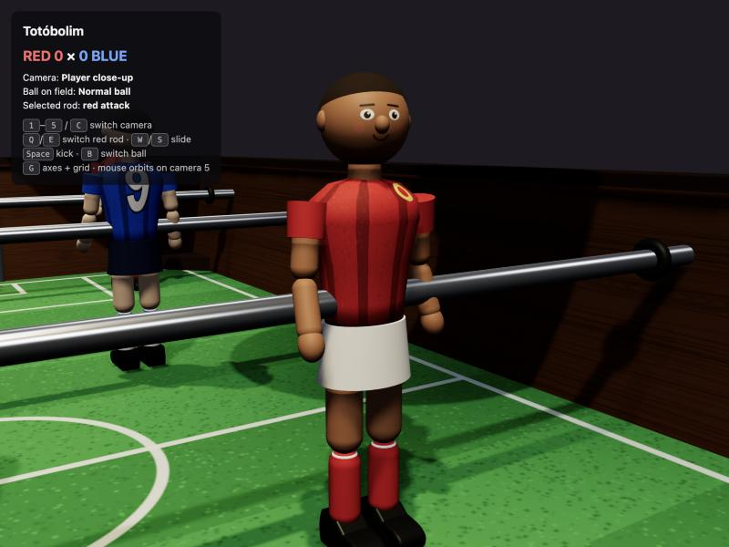

### 1.2 Cena inicial

**Sistema de coordenadas**:

- Tampo do campo em **y = 0**, no plano XZ.
- **Eixo X** = comprimento. O gol vermelho fica em x = −6 e o azul em x = +6.
- **Eixo Z** = largura. As hastes ficam ao longo de Z.
- Piso da sala em **y = −3,6**, que corresponde à altura da mesa.

| Haste | Time | x | Jogadores (z) |
|---|---|---|---|
| Defesa | Vermelho | −4,5 | −2,2 / 0 / 2,2 |
| Ataque | Azul | −1,5 | −1,4 / 1,4 |
| Ataque | Vermelho | +1,5 | −1,4 / 1,4 |
| Defesa | Azul | +4,5 | −2,2 / 0 / 2,2 |

As linhas são **intercaladas** como num pebolim real: a defesa de cada time fica perto do próprio gol e o ataque fica a 1,5 do centro.

| Elemento | Construção |
|---|---|
| Campo | `PlaneGeometry` 12 × 7 |
| Paredes laterais e de fundo | `BoxGeometry`. A parede do fundo tem 3 peças para formar a **abertura do gol** |
| Gols | Traves e travessão (`CylinderGeometry`), piso e rede (`PlaneGeometry`) |
| Rampas de canto | `ExtrudeGeometry` de um triângulo, girada para cada canto |
| Hastes | `CylinderGeometry` com manopla, ponteira (`TorusGeometry`). |
| Marcadores de gol (ábaco) | Fio com 6 contas por time, uma para cada gol necessário para vencer |
| Bolas | 3 esferas com raios diferentes: normal (0,22), pesada (0,18) e leve (0,30) |
| Sala | Piso e tapete (`PlaneGeometry`) |
| Luminárias pendentes | Fio, cúpula (`CylinderGeometry` com `openEnded`) e lâmpada |

### 1.3 Dificuldades da entrega 1

1. **Escolher a origem do boneco.** Para o chute girar em torno da haste e não dos pés, a origem precisou ficar no peito. Pernas, joelhos e chuteiras foram medidos a partir desse ponto até os pés quase encostarem no gramado.
2. **Peças espelhadas.** A primeira versão das rampas de canto usava `scale` negativo para espelhar, o que inverte a ordem dos vértices e deixa as faces do avesso. A solução foi girar a mesma geometria em Y para cada canto.
3. **Proporções.** Alturas de parede, haste, bola e boneco foram ajustadas para o boneco aparecer por cima da parede na câmera principal e a bola ter tamanho mais realista em relação ao jogador.

---

## Entrega 2: câmeras, projeção perspectiva e iluminação

### 2.1 Evolução em relação à entrega 1

- **Câmeras:** a entrega 1 tinha 5 câmeras de teste trocadas pelas teclas 1–5 (principal, superior, atrás do gol, close no jogador e órbita livre). Elas serviam só para inspecionar a cena. Nesta entrega viraram **3 poses com papel no jogo**, em uma única câmera que transita entre elas. As teclas 1–6 passaram a controlar as luzes.
- **Troca de tempo:** em vez de saltar, a câmera gira 180° em torno do campo.
- **Luzes:** as 6 luzes já existiam, mas não dava para isolar a contribuição de cada uma. Agora cada uma liga e desliga por tecla, e o painel mostra quais estão acesas.

### 2.2 Câmeras

| Pose | Quando | Posição → alvo |
|---|---|---|
| **1º tempo** | Início da partida | (0; 11; 11,5) → (0; −0,5; 0,4): elevada e inclinada, do lado das manoplas vermelhas |
| **2º tempo** | Quando o relógio do 1º tempo zera (120 s), ou tecla `T` | (0; 11; −11,5) → (0; −0,5; −0,4): mesma câmera espelhada, do outro lado |
| **Power-up "visão 2D"** | 8 s após o power-up (tecla `P` por enquanto) | (0; 17; ±0,01) → (0; 0; 0): vista de cima, como um Pong |

- Entre poses comuns, posição, alvo e campo de visão são interpolados suavemente.
- Na vista de cima, o deslocamento de ±0,01 em Z segue o tempo atual, mantendo a orientação de tela. Quando o power-up acaba, a câmera volta para a pose do tempo em andamento.
- As malhas das luminárias ficam na **camada 1** (`Object3D.layers`), desligada na vista de cima, para as cúpulas não taparem o campo. As luzes continuam funcionando.

**Giro na troca de tempo:** a câmera gira **180° no sentido horário** (visto de cima) em torno do centro do campo, sempre olhando para ele.

- Posição em coordenadas polares no plano XZ (`ângulo = atan2(x, z)`), com o ângulo indo de 0° a −180° em 3 s e suavização *smoothstep*. Raio (11,5) e altura (11) ficam constantes, e o alvo gira junto.
- Durante o giro o jogo pausa: relógio, hastes e bola param. A saída de bola acontece no fim.
- Voltando do 2º para o 1º tempo, o giro continua no mesmo sentido, de 180° a 360°.
- Medido no navegador: o ângulo passou por −11°, −36°, −74°, −114°, −150°, −174° e −180°, sempre mirando o centro do campo.

| 1º tempo | Giro | 2º tempo | Visão 2D |
|---|---|---|---|
|  | 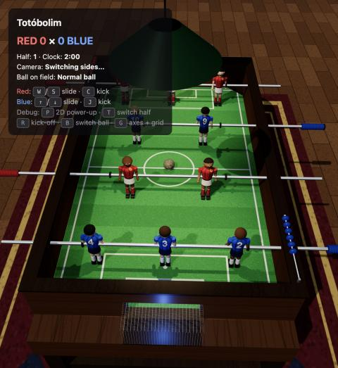 | 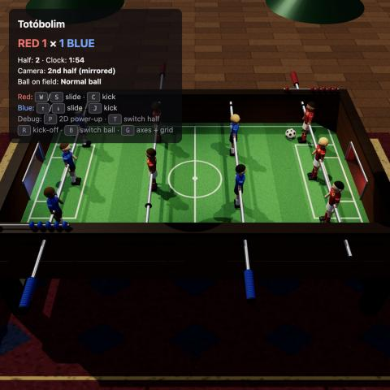 | 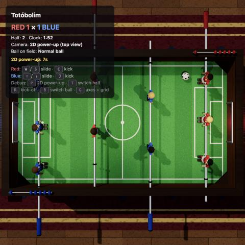 |

### 2.3 Projeção perspectiva

**Onde a matriz é definida e aplicada:**

| O quê | Onde |
|---|---|
| Criação da câmera perspectiva: FOV vertical 50°, proporção da janela, planos *near* 0,1 e *far* 200 | [`src/main.js:153`](src/main.js) — `new THREE.PerspectiveCamera(50, aspect, 0.1, 200)` |
| Recálculo da matriz quando o FOV muda (50° nas poses de tempo, 45° na vista de cima) | [`src/main.js:244`](src/main.js) (transição suave) e [`src/main.js:224`](src/main.js) (giro) — `camera.updateProjectionMatrix()` |
| Recálculo quando a janela muda de tamanho (nova proporção) | [`src/main.js:531`](src/main.js) |
| Aplicação a cada quadro | [`src/main.js:513`](src/main.js) — `renderer.render(scene, camera)` |

`updateProjectionMatrix()` monta a matriz a partir do FOV, da proporção e dos planos *near*/*far* ([código do Three.js r160](https://github.com/mrdoob/three.js/blob/r160/src/cameras/PerspectiveCamera.js)). No `render`, o Three.js envia essa matriz ao shader como o uniform `projectionMatrix`, e o vertex shader faz `gl_Position = projectionMatrix * mvPosition` ([trecho do shader](https://github.com/mrdoob/three.js/blob/r160/src/renderers/shaders/ShaderChunk/project_vertex.glsl.js)). A divisão por *w* que acontece depois é o que faz objetos distantes ficarem menores.

**Efeito nos objetos:** na captura abaixo, todos os bonecos usam o mesmo modelo e a mesma escala. O #3 vermelho, perto da câmera, ocupa quase metade da altura da tela; os azuis do fundo ficam bem menores, e as linhas paralelas do campo convergem.

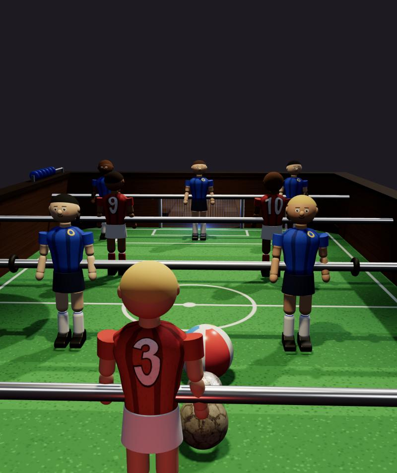

### 2.4 Iluminação: 6 fontes de luz

| Tecla | Luz | Tipo | Papel |
|---|---|---|---|
| `1` | Ambiente | `HemisphereLight` | Preenche áreas escuras (céu frio, chão quente) |
| `2` | Janela | `DirectionalLight` com sombra | Luz principal e sombras compridas dos bonecos |
| `3` | Luminária esquerda | `SpotLight` com sombra | Cone de luz "de bar" sobre a metade vermelha |
| `4` | Luminária direita | `SpotLight` com sombra | Cone sobre a metade azul |
| `5` | Gol vermelho | `PointLight` vermelha | Destaque dentro do gol |
| `6` | Gol azul | `PointLight` azul | Destaque dentro do gol |

Ao desligar uma luminária, a lâmpada dela também apaga (a emissão do material vai a zero). O painel lista as 6 luzes e risca as desligadas.

**Contribuição de cada luz** (mesma câmera, mesma cena):

| Todas ligadas | Só a janela (2) | Só as luminárias (3 e 4) |
|---|---|---|
| 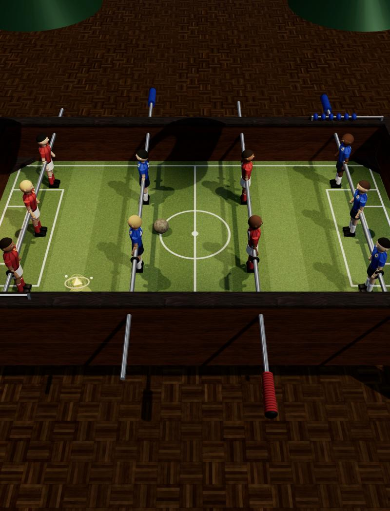 | 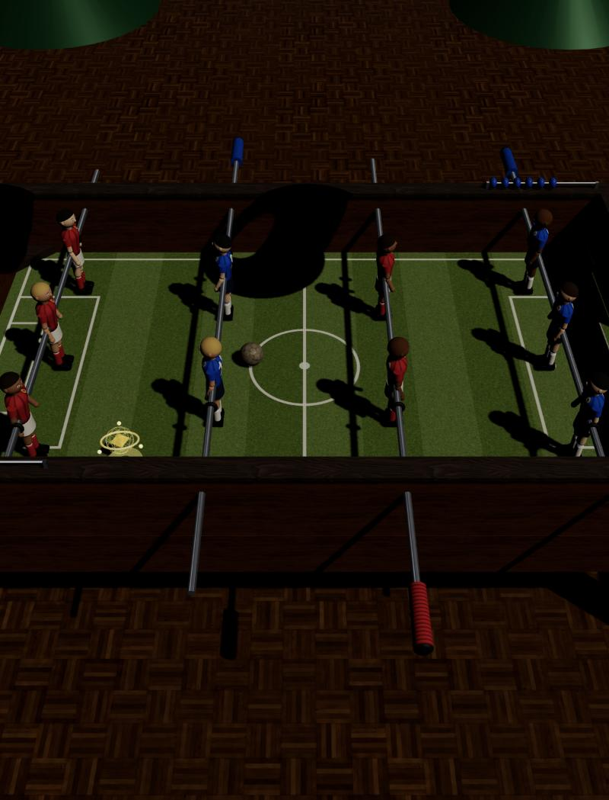 | 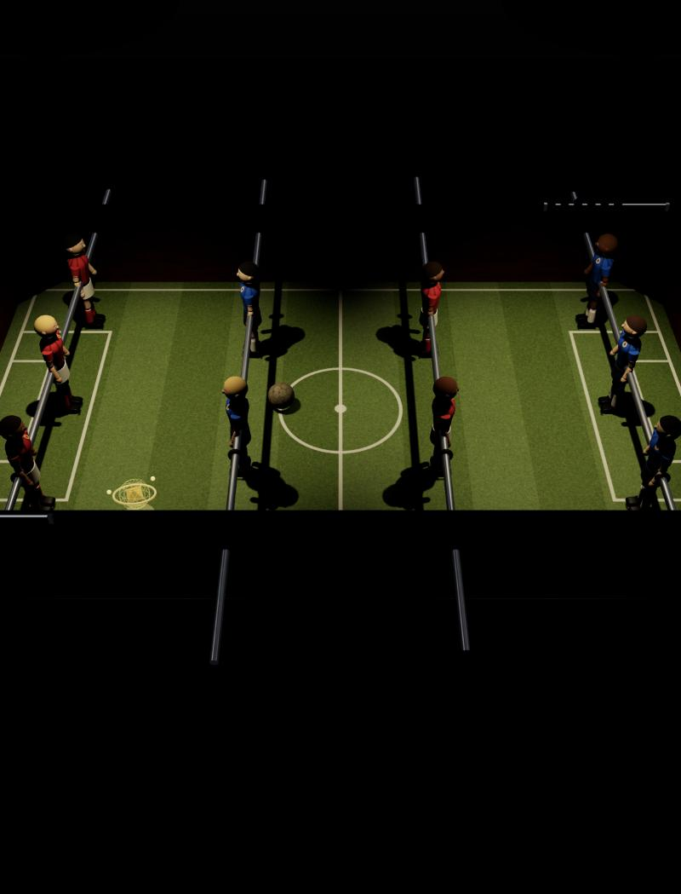 |

| Só os gols (5 e 6) | Só a ambiente (1) | Todas apagadas |
|---|---|---|
| 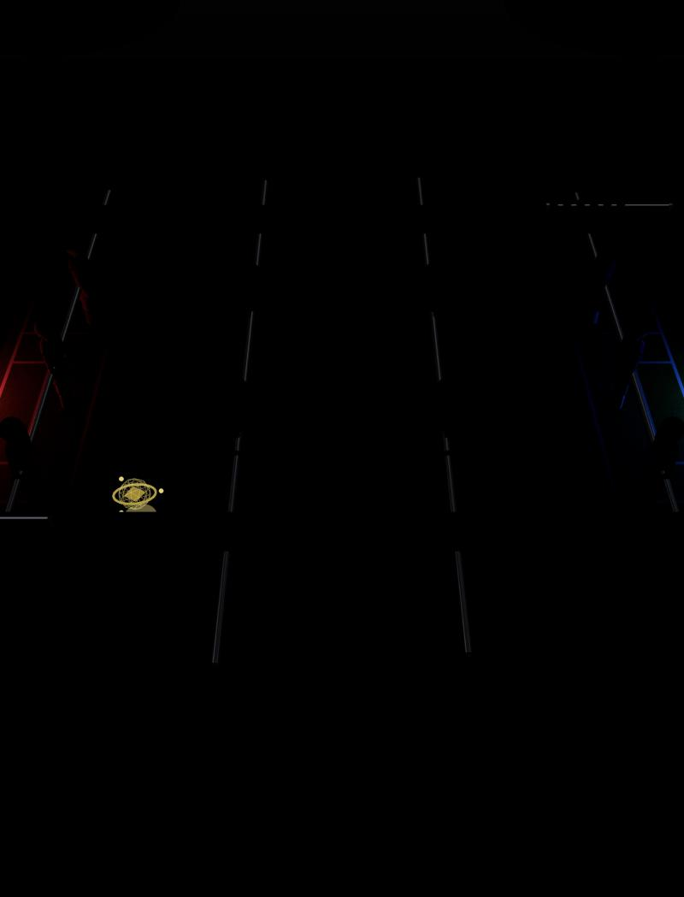 | 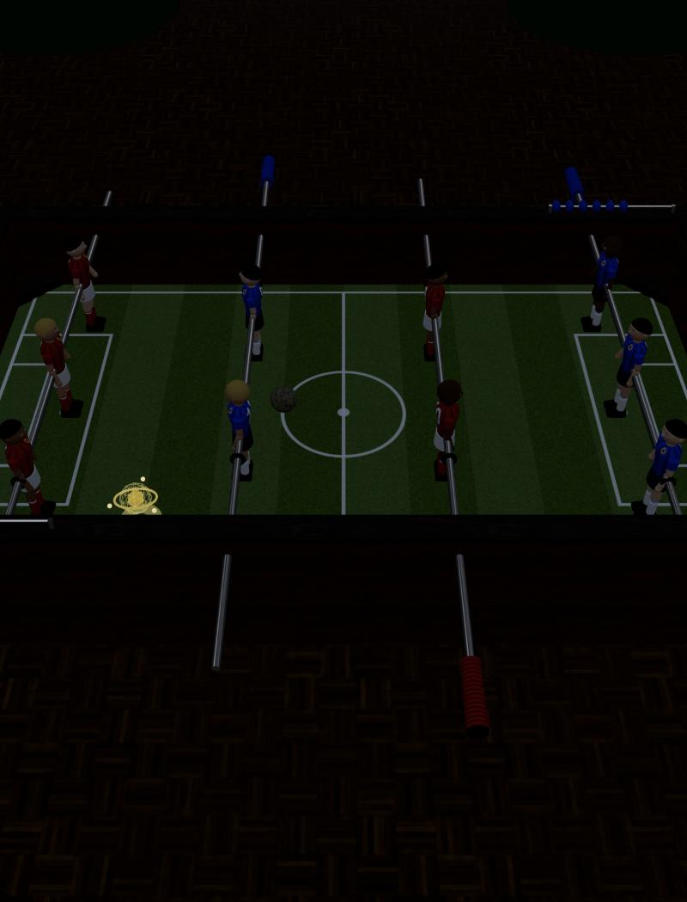 | 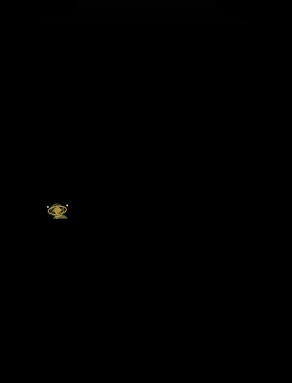 |

- **Só a janela:** sombras longas e diagonais e a sombra da cúpula sobre o campo; a sala fica iluminada.
- **Só as luminárias:** dois cones de luz sobre o campo, sombras curtas embaixo dos bonecos e a sala no escuro, como num bar.
- **Só os gols:** quase tudo preto, com brilho vermelho e azul só dentro e perto de cada gol.
- **Só a ambiente:** cena inteira visível, mas sem sombras e sem volume.
- **Todas apagadas:** tela preta. Só o modelo do power-up continua visível, porque tem brilho próprio (material emissivo) de propósito, para ser achado no campo.

**Reflexo dos metais:** hastes, traves, expositor e bola pesada usam um mapa de ambiente (`envMap`, gerado a partir do `RoomEnvironment`) para ter reflexo metálico. Esse mapa é iluminação baseada em imagem e não passa pelas luzes da cena, então os metais continuavam brilhando mesmo com tudo apagado. A correção ([`updateEnvironmentReflection` em `src/environment.js`](src/environment.js)) dá a cada luz um peso no reflexo (ambiente 0,3, janela 0,3, cada luminária 0,15, cada gol 0,05; soma 1) e multiplica a intensidade do `envMap` de todos os metais pela soma das luzes acesas. Com tudo apagado o reflexo vai a zero; com só as luminárias, cai para 30%.

### 2.5 Dificuldades da entrega 2

1. **Luminárias tapando a vista de cima:** resolvido com camadas (`layers`), descrito em 2.2.
2. **Controles com a câmera espelhada:** no 2º tempo, "para cima" na tela vira +Z, então o sentido do deslize é invertido conforme o tempo.
3. **Troca de tempo brusca:** a câmera deslizava em linha reta por cima do campo. A solução foi o giro em coordenadas polares.
4. **Metais acesos com as luzes apagadas:** o reflexo do mapa de ambiente não depende das luzes da cena. A intensidade dele passou a acompanhar as luzes acesas (2.4).

---

## Entrega 3: texturas e materiais

### 3.1 Evolução em relação à entrega 2

- **Imagens externas:** a bola normal virou um **modelo glTF** com textura fotográfica (Poly Haven), e a bola pesada ganhou **textura PBR de metal** (ambientCG) com cor, relevo (normal map), rugosidade e metalicidade.
- **Cenário fotográfico:** o gramado, o piso e as duas madeiras da mesa, que eram desenhados em código, passaram a usar texturas PBR do ambientCG (cor, normal map e rugosidade). As marcações do campo viraram uma camada transparente por cima da grama.
- **UVs em unidades do mundo:** as peças de madeira (caixas e cilindros de tamanhos muito diferentes) tiveram as UVs convertidas para unidades do mundo, então a madeira tem a mesma escala em todas elas e o veio segue o lado mais comprido de cada face (seção 3.3).
- **Tapete removido:** o tapete chegou a receber uma textura de carpete, mas não combinou com o restante da sala e foi retirado; o piso de parquet ficou aparente embaixo da mesa.

| Entrega 2 (texturas em código) | Entrega 3 (texturas fotográficas) |
|---|---|
| 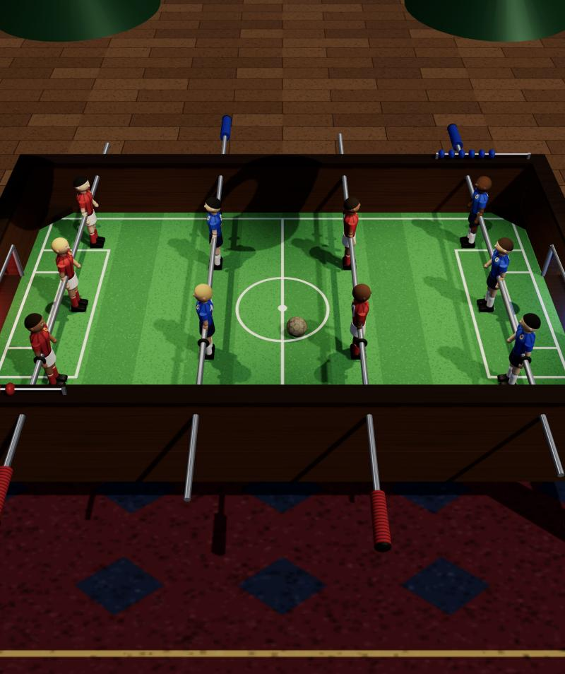 | 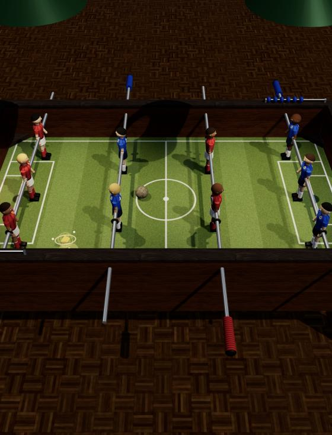 |

| Gramado de perto | Piso de parquet | Madeiras da mesa |
|---|---|---|
| 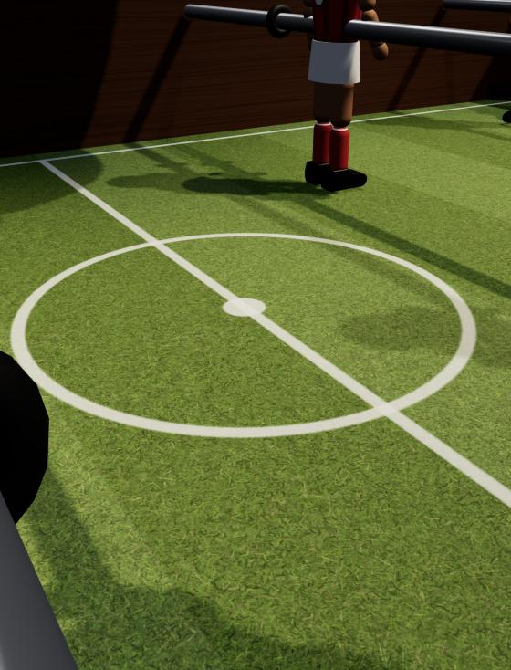 | 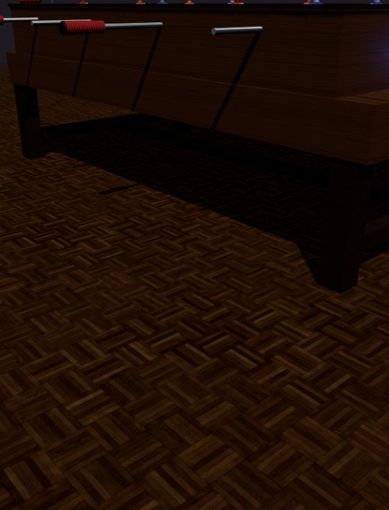 | 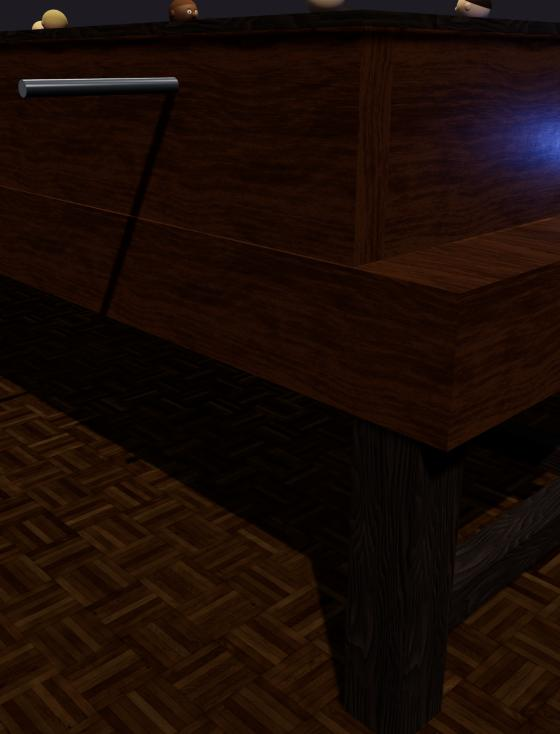 |

- **Mapeamento corrigido:** a textura de metal formava um "redemoinho" no polo da esfera; a bola pesada passou a usar uma **esfera derivada de cubo**.
- **Demonstração do mapeamento:** tecla `U` (grade de UV), página [textures.html](textures.html) e PNGs das texturas geradas em código.
- **Mantido:** as 6 luzes da entrega 2, com as teclas 1–6.

### 3.2 Texturas usadas

São **9 tipos de textura gerados em código**, alguns com variações (10 camisas, uma por número; 5 rostos, um por tom de pele; manopla e meião nas cores de cada time), e **18 imagens externas** de 6 materiais. Além disso, há a grade de UV usada só para depuração. As texturas cobrem personagens (camisa, meião, rosto), cenário (grama, marcações, madeiras, piso, rede, manoplas) e bolas. Todas aparecem na galeria `textures.html`.

| Geradas em código | Imagens externas |
|---|---|
| 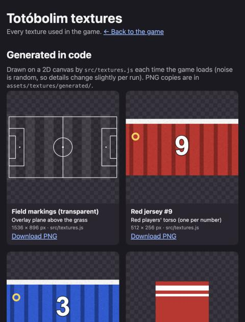 | 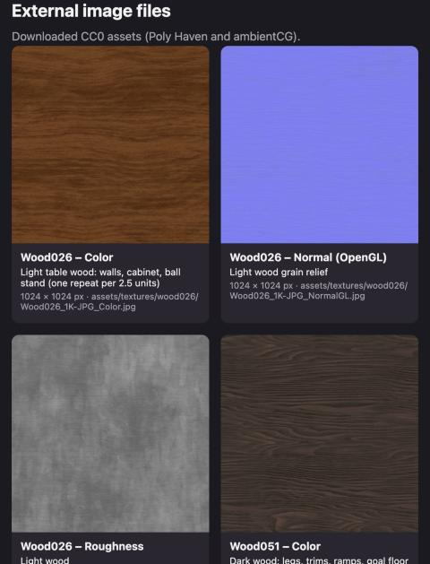 |

| Textura | Origem | Onde é usada |
|---|---|---|
| Grass005 (cor, normal, rugosidade) | **ambientCG** | Gramado do campo |
| Marcações do campo (transparente) | Código | Camada por cima da grama: linhas e faixas de corte |
| Wood026, madeira clara (cor, normal, rugosidade) | **ambientCG** | Paredes, gabinete e expositor de bolas |
| Wood051, madeira escura (cor, normal, rugosidade) | **ambientCG** | Pés, travessas, frisos, rampas de canto e piso do gol |
| WoodFloor070 (cor, normal, rugosidade) | **ambientCG** | Piso da sala |
| Rede (com transparência) | Código | Redes dos gols |
| Manopla (vermelha / azul) | Código | Manoplas das hastes |
| Camisa com número | Código | Tronco dos bonecos |
| Meião | Código | Canelas dos bonecos |
| Rosto (5 tons de pele) | Código | Cabeça dos bonecos |
| Bola de praia | Código | Bola leve |
| Football (cor + AO/rugosidade/metal) | **Poly Haven (glTF)** | Bola normal |
| Metal059C (cor, normal, rugosidade, metalicidade) | **ambientCG** | Bola pesada |

**Arquivos de imagem entregues:**
- `assets/models/football/textures/` e `assets/textures/{metal059c, grass005, woodfloor070, wood026, wood051}/`: imagens externas usadas pelo jogo.
- `assets/textures/generated/`: 16 PNGs exportados da galeria (um exemplo de camisa por time e um de cada uma das demais). As texturas geradas são desenhadas de novo a cada carregamento, e o ruído é aleatório, então os detalhes mudam um pouco a cada execução.

### 3.3 Coordenadas UV de cada modelo

A tecla `U` troca o mapa de cor (`map`) de todos os materiais texturizados por uma **grade de UV**: colunas **A–H crescem com u** (da esquerda para a direita) e linhas **1–8 crescem com v** (de baixo para cima). A cor também muda com u (matiz) e v (claridade). A grade preserva o *repeat* de cada textura original, então mostra exatamente como cada malha recebe a sua textura.

| Visão geral | Boneco | Bolas |
|---|---|---|
| 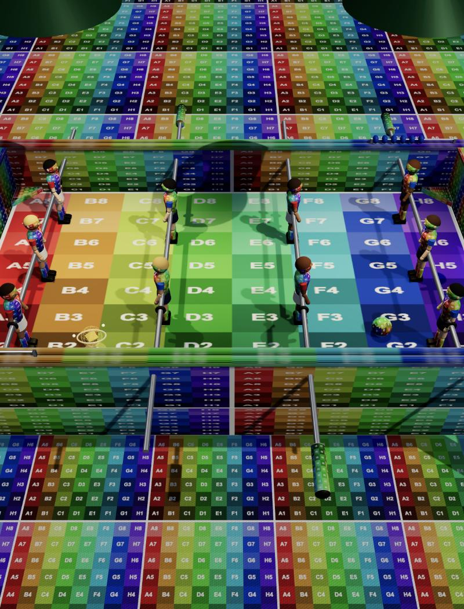 | 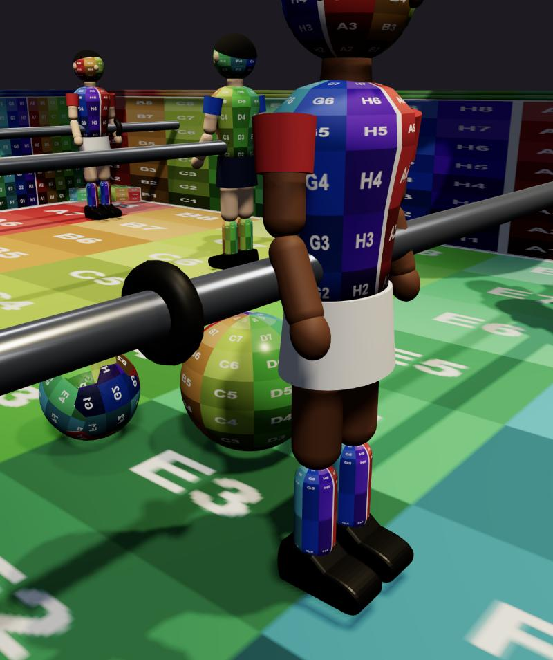 | 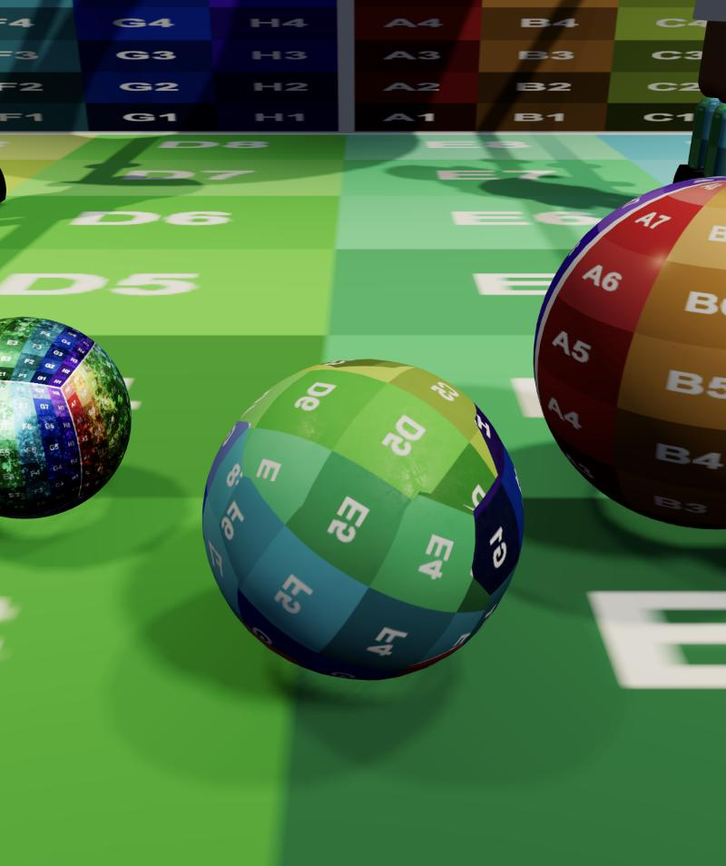 |

| Malha | Geometria | Como u e v cobrem a superfície | Distorção |
|---|---|---|---|
| Campo: grama | `PlaneGeometry` 12 × 7 | u de 0 (gol vermelho, x = −6) a 1 (gol azul, x = +6); v de 0 (z = +3,5) a 1 (z = −3,5); *repeat* 6 × 3,5, então cada repetição cobre 2 × 2 unidades | Nenhuma: repetição quadrada sobre imagem quadrada (1024 × 1024) |
| Campo: marcações | Segundo `PlaneGeometry` 12 × 7, 0,001 acima da grama | Mesmo u e v da grama, sem repetição | Nenhuma: o canvas tem 1536 × 896 px, a mesma proporção 12:7. A grade de teste é quadrada, por isso aparece esticada no campo e cobre a grade repetida da grama embaixo |
| Tronco | `LatheGeometry` | u dá a volta no corpo: **u = 0 é a frente (+Z)** e **u = 0,5 são as costas**; v sobe da cintura (0) à gola (1) | Quase nenhuma: a circunferência (~1,1) é cerca do dobro da altura (~0,6), igual à proporção 2:1 do canvas (512 × 256). Por isso o número foi desenhado no centro do canvas, que cai nas costas |
| Cabeça | `SphereGeometry` | Equirretangular: u é a longitude, com a **frente (+Z) em u = 0,25**; v é a latitude | Olhos e boca desenhados em x = 128 de 512 px, perto do equador, onde a projeção não estica. O topo fica escondido pelo cabelo |
| Meião | `CapsuleGeometry` | u dá a volta na canela, v sobe ao longo dela | Faixas horizontais, que não denunciam esticamento |
| Peças de madeira (paredes, gabinete, pés, travessas, frisos, piso do gol, expositor) | `BoxGeometry` e `CylinderGeometry` com **UVs em unidades do mundo** ([`src/uv.js`](src/uv.js)) | O `BoxGeometry` nasce com u e v de 0 a 1 em cada face; cada face tem as UVs multiplicadas pela sua largura e altura reais. No cilindro, a lateral usa circunferência × altura e as tampas usam o diâmetro. O material usa *repeat* = 1 / 2,5, então a madeira se repete a cada 2,5 unidades em qualquer peça. Se a face é mais alta que larga (pés), u e v são trocados para o veio correr ao longo do comprimento | Nenhuma. Antes, cada face recebia a imagem inteira (vezes um *repeat* fixo do material), então a parede de 12,6 de comprimento e uma face de 0,3 mostravam a madeira em escalas completamente diferentes. Na grade de UV, todas as peças mostram quadrados do mesmo tamanho, e os pés mostram as letras giradas ([captura](screenshots/uv-checker-wood.jpg)) |
| Rampas de canto | `ExtrudeGeometry` | O gerador de UV padrão da extrusão já usa as coordenadas do perfil, ou seja, unidades do mundo | Mesma escala das demais peças de madeira |
| Piso | `PlaneGeometry` 80 × 80 | *Repeat* 13,3 × 13,3: cada repetição cobre 6 × 6 unidades | Nenhuma: imagem quadrada em área quadrada |
| Rede | `PlaneGeometry` | *Repeat* 4 × 3 | Malha quadrada mantida |
| Manopla | `CylinderGeometry` | u dá a volta, v ao longo do cabo | Anéis horizontais, sem distorção visível |
| Bola leve | `SphereGeometry` | Equirretangular | Os gomos convergem nos polos, que foram pintados de branco para esconder isso |
| Bola normal | Modelo glTF | UV feita pelo autor do modelo, em ilhas recortadas (algumas espelhadas, como mostram as letras invertidas na grade) | A textura fotográfica foi pintada para essas ilhas, então se encaixa sem emendas visíveis |
| Bola pesada | **Esfera derivada de cubo** | Cada uma das 6 faces de um `BoxGeometry` (24 × 24 subdivisões) tem seu quadrado de UV de 0 a 1; os vértices são empurrados até o raio | Sem polos. Na grade, cada face mostra a grade inteira, quase sem deformação |

**Antes e depois na bola pesada:** na `SphereGeometry`, toda a linha de cima da textura converge para um único ponto no polo e forma um redemoinho ([antes](screenshots/balls-before-cube-sphere.jpg)). Na esfera derivada de cubo, cada vértice do cubo subdividido é normalizado até o raio e recebe a direção radial como normal; a textura quadrada e repetível cobre cada face sem polo ([depois](screenshots/heavy-ball-cube-sphere.png)).

### 3.4 Interação da iluminação com as texturas

Todos os materiais texturizados são `MeshStandardMaterial` (modelo físico do Three.js): a cor final de cada pixel é a cor da textura multiplicada pela luz que chega ali, então sombras, cones de luz e cores das luzes aparecem por cima das texturas (ver as capturas da seção 2.4: as listras do campo e as camisas continuam legíveis em todas, com a luz mudando).

A grama e o piso também têm **normal map** e **mapa de rugosidade**: os fios da grama e as frestas do parquet ganham relevo sob as luminárias, e a rugosidade alta deixa essas superfícies foscas, sem brilho espelhado.

Na bola pesada, além da cor:
- O **normal map** muda a direção da normal pixel a pixel, então o relevo do metal reage à posição de cada luz.
- Os mapas de **rugosidade** e **metalicidade** definem onde o brilho é mais concentrado.
- O **mapa de ambiente** dá o reflexo metálico; a intensidade dele acompanha as luzes acesas (2.4), então o metal escurece junto com o resto da cena.

| Só a luz ambiente | Ambiente + luminária esquerda |
|---|---|
| 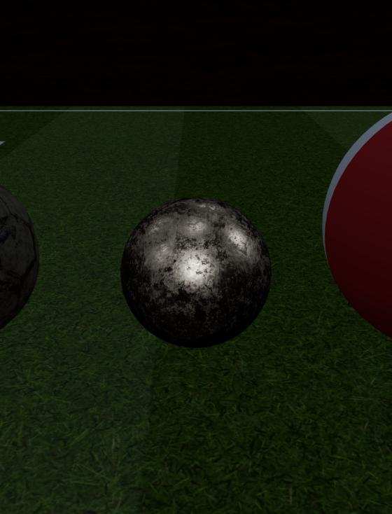 | 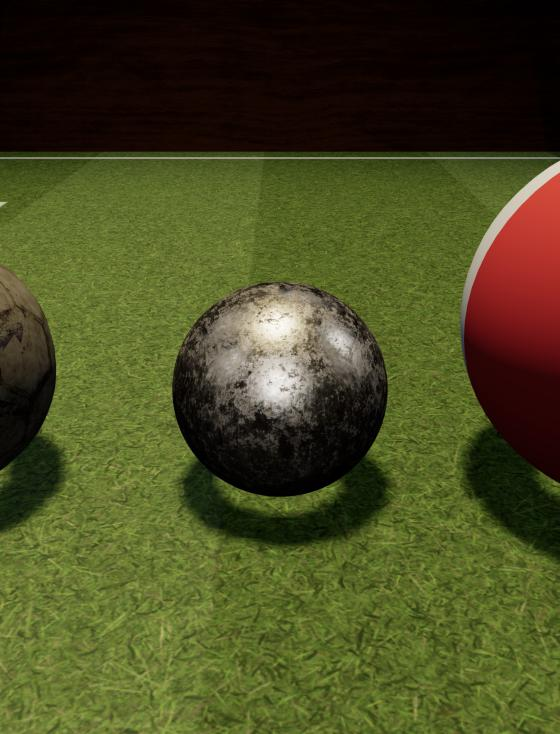 |

Com só a ambiente, o gramado e a bola de couro ficam escuros e sem sombra, mas as texturas ainda são reconhecíveis; o metal mantém parte do reflexo (30%, o peso da luz ambiente). Com a luminária, o gramado e a bola normal clareiam, as sombras aparecem embaixo das bolas e o relevo do metal fica mais marcado.

### 3.5 Dificuldades da entrega 3

1. **Rosto e número no lugar certo.** A frente da `SphereGeometry` fica em u = 0,25 e a do `LatheGeometry` em u = 0. Foi preciso descobrir isso para desenhar o rosto na frente da cabeça e o número nas costas.
2. **Textura espremida no polo:** resolvido com a esfera derivada de cubo (3.3).
3. **Normal map faltando no glTF.** O modelo da bola apontava para um `.jpg` que não vinha no zip (só havia `.exr`), e o macOS não conseguiu converter o `.exr`. A referência foi removida do `football_2k.gltf`; a bola usa cor e rugosidade.
4. **Gomos da bola em mapa equirretangular.** Na textura gerada em código para a bola normal (usada enquanto o glTF carrega), os pentágonos foram esticados horizontalmente para compensar a projeção.
5. **Cache do navegador.** Depois de mudar os módulos, o navegador às vezes continuava executando a versão antiga; é preciso recarregar sem cache.
6. **Marcações sobre a grama fotográfica.** As linhas do campo eram desenhadas junto com a grama no mesmo canvas. Com a foto repetida 6 × 3,5 vezes, isso não funciona mais (as linhas se repetiriam). As marcações foram para um segundo plano transparente, 0,001 acima da grama, com `polygonOffset` e sem escrita no *depth buffer* para não piscar (*z-fighting*).
7. **Escala das texturas repetidas.** O *repeat* de cada textura fotográfica é calculado pelo tamanho desejado de cada repetição em unidades do mundo (grama 2 × 2, piso 6 × 6), para os texels ficarem quadrados e a escala ficar crível ao lado dos bonecos.
8. **Madeira esticada nas peças da mesa.** As peças têm tamanhos muito diferentes (parede de 12,6 × 1,4, friso de 0,08 de altura, pé de 0,55 × 2,4), e cada face do `BoxGeometry` recebia a textura inteira. Um único *repeat* no material não resolve, porque vale igual para todas as faces. A solução foi reescrever as UVs de cada face em unidades do mundo (`src/uv.js`) e deixar o *repeat* só definir o tamanho da repetição.

---

## 4. Jogabilidade desenvolvida em paralelo

### 4.1 Hastes

O curso de cada haste é `travel = min(W/2 − 0,35 − maior z do slot, espaçamento / 2)`:

- Nas linhas de 3 (±0,95), o limite é a parede.
- Nas linhas de 2 (±1,4), a trava vem antes, na metade do espaço entre os bonecos; como a bola nunca para, isso já cobre o campo inteiro.
- O comprimento da haste é calculado a partir do curso, para a ponta e a manopla nunca entrarem na mesa. Os para-choques encostam na parede interna exatamente no fim do curso.

### 4.2 Física da bola (`src/physics.js`)

- **Saída de bola:** no início, em cada tempo e depois de cada gol, a bola sai do centro para um lado **sorteado** (+X ou −X), com um pequeno ângulo. A velocidade depende da massa: a leve sai mais rápida e a pesada mais lenta.
- **Movimento:** atrito, quique nas paredes, detecção de gol, placar no painel e contas do ábaco. O movimento é dividido em até 8 subpassos por quadro, para a bola rápida não atravessar os bonecos.
- **Velocidade mínima:** a bola nunca para (mínimo 1,2 u/s, máximo 14 u/s), para não travar em cantos.
- **Colisão com os bonecos:** na altura da bola, cada boneco ocupa um retângulo no plano XZ (0,22 × 0,34) cuja posição acompanha a rotação da haste. Com o pé levantado (θ > ~36°), a bola passa por baixo.
- **Rebote:** sem chute, a bola reflete em relação à velocidade do pé e do deslize da haste.
- **Chute com raspão:** a força depende da distância lateral `dz` entre a bola e o eixo do boneco: `força = 0,3 + 0,7 · (1 − |dz| / (meia largura + raio))`, dividida por `√massa`. Medido com a bola normal: `dz = 0` → 9,3 u/s reto; 0,15 → 6,5; 0,30 → 4,3; 0,36 → 3,3 com desvio lateral.

Dificuldades: a haste de ataque tinha comprimento fixo e saía da mesa com o curso antigo de ±1,75; e testar a bola contra cada malha do boneco seria caro e instável, por isso o volume simplificado.

### 4.3 Power-up coletável: modelo (`src/powerup.js`)

O power-up vai aparecer aleatoriamente pelo campo e ser coletado durante a partida. **Por enquanto existe só o modelo**, com um exemplo decorativo flutuando no campo vermelho; a visão 2D continua sendo ativada pela tecla `P`.

```
powerUp (origem = ponto no gramado)
 ├─ baseGlow (anel no chão que pulsa, marca a posição)
 └─ floating (sobe e desce)
      ├─ core   (OctahedronGeometry com flatShading: uma "gema" facetada que gira)
      ├─ shell  (IcosahedronGeometry em wireframe ao redor do núcleo)
      ├─ ring   (TorusGeometry inclinado, girando em outro eixo)
      └─ orbit ─ 3 esferas pequenas girando em volta
```

Cada tipo de power-up tem cor e formato de núcleo próprios (`POWER_UP_TYPES`), para ser reconhecido de longe; a visão 2D é amarela com núcleo octaédrico. As texturas do power-up ficam para a próxima etapa.

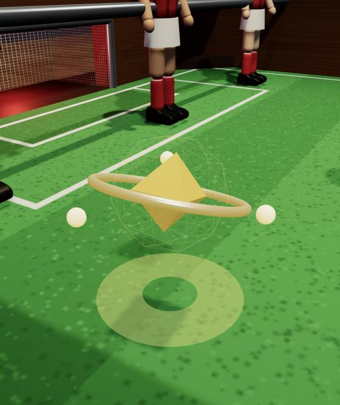

---

## 5. Origem dos modelos, texturas e bibliotecas

- **Modelos criados:** bonecos, mesa, gols, hastes, rampas, ábacos, expositor, power-up, luminárias e sala, todos em código, com primitivas e malhas paramétricas do Three.js.
- **Modelo externo:** bola normal, [Football](https://polyhaven.com/a/football) do Poly Haven, glTF 2K ([licença CC0](https://polyhaven.com/license)). Só a malha `football_inflated` é usada; a versão murcha do mesmo arquivo é ignorada. A malha é centralizada e escalada para o raio 0,22. A referência ao normal map (que só vinha em `.exr`) foi removida do `.gltf`.
- **Texturas externas** (ambientCG, 1K JPG, [licença CC0](https://docs.ambientcg.com/license/)):
  - Bola pesada: [Metal 059 C](https://ambientcg.com/view?id=Metal059C).
  - Gramado do campo: [Grass 005](https://ambientcg.com/view?id=Grass005).
  - Piso da sala: [Wood Floor 070](https://ambientcg.com/view?id=WoodFloor070).
  - Madeira clara da mesa e do expositor: [Wood 026](https://ambientcg.com/view?id=Wood026).
  - Madeira escura da mesa: [Wood 051](https://ambientcg.com/view?id=Wood051).
- **Texturas criadas pelo grupo:** todas as demais, geradas em código.
- **Bibliotecas:**
  - [Three.js r160](https://github.com/mrdoob/three.js/tree/r160) (licença MIT), via [jsDelivr](https://cdn.jsdelivr.net/npm/three@0.160.0/).
  - Addons do Three.js: [`RoomEnvironment`](https://github.com/mrdoob/three.js/blob/r160/examples/jsm/environments/RoomEnvironment.js) (reflexo das peças metálicas) e [`GLTFLoader`](https://threejs.org/docs/#examples/en/loaders/GLTFLoader) (modelo da bola normal).
- **Referências da API:** [PerspectiveCamera](https://threejs.org/docs/#api/en/cameras/PerspectiveCamera), [LatheGeometry](https://threejs.org/docs/#api/en/geometries/LatheGeometry), [ExtrudeGeometry](https://threejs.org/docs/#api/en/geometries/ExtrudeGeometry), [CapsuleGeometry](https://threejs.org/docs/#api/en/geometries/CapsuleGeometry), [SphereGeometry](https://threejs.org/docs/#api/en/geometries/SphereGeometry), [CanvasTexture](https://threejs.org/docs/#api/en/textures/CanvasTexture), [MeshStandardMaterial](https://threejs.org/docs/#api/en/materials/MeshStandardMaterial), [Layers](https://threejs.org/docs/#api/en/core/Layers).

---

## 6. O que ainda falta implementar

- [x] Controles dos dois times (duas hastes juntas por time).
- [x] Saída de bola sorteada, atrito, quique, gol, placar e ábaco.
- [x] Colisão com os bonecos, chute com raspão e velocidade mínima.
- [x] Câmeras do 1º e 2º tempo com giro e câmera do power-up 2D.
- [x] Ligar/desligar cada luz.
- [x] Texturas externas, grade de UV e galeria de texturas.
- [x] Modelo do power-up.
- [ ] **Power-ups coletáveis:** aparecer aleatoriamente pelo campo de tempos em tempos e ser coletados pela bola, cada um com cor e formato próprios.
- [ ] **Condição de vitória** (6 gols) e tela de vitória ou derrota.
- [ ] **Mecânicas especiais das bolas:** a pesada atordoa o boneco atingido na cabeça; a leve pode estourar e atordoar a linha inteira.
- [ ] Animação de atordoamento dos bonecos (os pivôs de cabeça, braços e pernas já existem).
- [ ] Ajustes finais.
